# Patrimonio

Patrimonio es una aplicación web para controlar las finanzas personales: el dinero disponible, los ahorros, las tarjetas de crédito, los ingresos y gastos del día a día, y estadísticas de cómo evoluciona todo.

**¿Qué problema resuelve?** Mucha gente no sabe cuánto dinero tiene realmente, porque una parte está ahorrada para algo y otra ya está comprometida con la tarjeta. Patrimonio muestra en una sola pantalla el total y cómo se reparte:

**Patrimonio = Disponible + Ahorros + Reserva de tarjeta**

- **Disponible:** la plata que podés usar hoy. Sube con un ingreso y baja con un gasto.
- **Ahorros:** el dinero separado en objetivos (por ejemplo "Auto" o "Vacaciones"). Pasar plata del disponible a un objetivo, o devolverla, no cambia el patrimonio: solo la cambia de lugar. Si la *utilizás*, cuenta como un gasto.
- **Reserva de tarjeta:** cuando comprás con tarjeta, esa plata sale del disponible y queda reservada para pagar el resumen. Al pagar el período sale de la reserva, y el patrimonio baja una sola vez.

## Integrantes

Proyecto individual.

| Integrante | Qué desarrolló |
|---|---|
| Lautaro Espejo | Todo el proyecto: diseño UX/UI en Figma, frontend en React y backend en Node.js con Express |

Proyecto final de **Programación 4**, Campus Sede Este, **Universidad Champagnat**. Profesor: Lic. Ignacio G. Fontaine Digier.

## Tecnologías

- **Frontend:** React 19 + Vite.
- **Backend:** Node.js + Express 5 (con `cors`), con módulos ES.
- **Persistencia:** archivos JSON en el servidor (sin base de datos).

## Requisitos

- **Node.js 20.19 o superior** (o 22.12 o superior). Es lo que piden Vite 8 y su plugin de React en el frontend; el backend (Express 5) funciona desde Node 18. El proyecto se probó con Node 24.
- **npm**, que viene incluido con Node.js.
- **Git**, para clonar el repositorio.

Para saber qué versión tenés, abrí una terminal y escribí `node -v`.

## Instalación y ejecución

Los comandos son para Windows (PowerShell o el símbolo del sistema), pero son los mismos en otros sistemas. Vas a necesitar **dos terminales abiertas al mismo tiempo**: una para el backend y otra para el frontend.

### 1. Clonar el repositorio

```
git clone https://github.com/laute10/prog4-proyecto-patrimonio-final.git
cd prog4-proyecto-patrimonio-final
```

### 2. Iniciar el backend (terminal 1)

```
cd backend
npm install
npm start
```

- Queda escuchando en **http://localhost:3000** y muestra `Servidor escuchando en http://localhost:3000`.
- La primera vez muestra también `Se creó data/patrimonio.json a partir de la semilla.`: el archivo de datos `backend/src/data/patrimonio.json` se genera solo, copiando los datos de ejemplo de `backend/src/data/semilla.json`.
- Para comprobar que anda, abrí http://localhost:3000/api/salud en el navegador: tiene que responder `{"estado":"ok"}`.
- `npm run dev` hace lo mismo que `npm start`, pero reinicia el servidor cada vez que guardás un archivo (útil mientras se programa).
- Dejá esta terminal abierta: si la cerrás, se apaga el servidor.

### 3. Iniciar el frontend (terminal 2)

Abrí otra terminal en la carpeta del proyecto y ejecutá:

```
cd frontend
npm install
npm run dev
```

Abrí en el navegador la dirección que aparece: **http://localhost:5173**.

**Importante:** el backend tiene que estar corriendo antes de abrir el frontend. Si no, la aplicación muestra "No se pudieron cargar los datos" con un botón **Reintentar**: iniciá el backend y tocá ese botón.

### La dirección de la API

El frontend no tiene la dirección del backend escrita en el código: la lee de la variable `VITE_API_URL` del archivo `frontend/.env`, que ya viene en el repositorio con este valor:

```
VITE_API_URL=http://localhost:3000/api
```

No hace falta tocarlo. Si alguna vez el backend corre en otro puerto, cambiá ese valor y volvé a ejecutar `npm run dev` en el frontend.

## Usuario y datos de ejemplo

**El inicio de sesión es simulado:** no hay base de datos de usuarios ni contraseñas guardadas. Para entrar:

- En **Iniciar sesión**, escribí cualquier correo con formato válido (por ejemplo `lautaro@correo.com`) y cualquier contraseña que no esté vacía.
- También podés usar **Crear cuenta** (nombre, correo, una contraseña de al menos 8 caracteres y su repetición): al crearla entrás directamente.
- **Recuperar contraseña** valida el correo y muestra un mensaje de confirmación, pero no envía ningún correo.

Todos los usuarios ven y modifican **el mismo conjunto de datos**. La aplicación arranca con datos de ejemplo: ingresos, gastos, tres objetivos de ahorro y una tarjeta Visa con un período abierto y otro ya pagado. Las fechas de la semilla se calculan a partir del día de hoy, así que el ejemplo nunca queda viejo.

Todo lo que cambies desde la aplicación se guarda en `backend/src/data/patrimonio.json` y sigue ahí aunque reinicies el servidor.

**Para volver a los datos de ejemplo:**

1. Detené el backend con `Ctrl + C` en la terminal 1.
2. Borrá el archivo de datos (desde la carpeta del proyecto):
   - PowerShell: `Remove-Item backend\src\data\patrimonio.json`
   - Símbolo del sistema: `del backend\src\data\patrimonio.json`
3. Volvé a iniciar el backend con `npm start`: el archivo se crea de nuevo desde la semilla.

## Estructura de carpetas

```
prog4-proyecto-patrimonio-final/
├── backend/
│   ├── package.json          scripts start y dev; dependencias: express y cors
│   └── src/
│       ├── index.js          arma la app de Express: middlewares, rutas, 404 y errores
│       ├── routes/           un express.Router() por recurso
│       ├── controllers/      qué hace cada endpoint y con qué código responde
│       ├── middlewares/      registro de pedidos, ruta inexistente (404) y manejo de errores
│       ├── validaciones/     validación a mano de los datos de cada pedido
│       ├── reglas/           cómo afecta cada movimiento al disponible, ahorros y reserva
│       ├── servicios/        lectura y escritura del JSON, totales y tarjetas
│       └── data/             semilla.json (ejemplo) y patrimonio.json (se crea al iniciar)
├── frontend/
│   ├── .env                  VITE_API_URL, la dirección de la API
│   ├── docs/                 planificación, árbol de componentes y capturas de pruebas de la API
│   ├── public/               archivos estáticos (íconos)
│   └── src/
│       ├── App.jsx           sesión, navegación entre pantallas y tema claro/oscuro
│       ├── pages/            una pantalla por archivo (Inicio, Movimientos, Ahorros, Tarjetas…)
│       ├── components/       paneles, modales, formularios, gráficos e íconos reutilizables
│       ├── hooks/            usePatrimonio: el estado financiero; cada acción llama a la API
│       ├── utils/            pedidos a la API, formato de montos y fechas, validaciones
│       └── index.css         todos los estilos, con los colores en variables
├── capturas/                 capturas de todas las pantallas (escritorio y móvil)
└── docs/                     presentación de la etapa 1
```

## Endpoints de la API

Base: `http://localhost:3000/api`. Los datos se envían y se reciben en JSON. Los errores siempre responden JSON con la forma `{ "error": "mensaje" }`. Los códigos posibles son 200, 201, 204, 400 (datos inválidos o una regla que no se cumple), 404 (no existe) y 500 (error del servidor). Una ruta que no existe responde 404 en JSON.

Son **24 endpoints**:

| # | Método | Ruta | Descripción |
|---|---|---|---|
| 1 | GET | `/api/salud` | Comprueba que el servidor está funcionando |
| 2 | GET | `/api/patrimonio` | Todos los datos más los totales (disponible, ahorros, reserva y patrimonio); es la carga inicial del frontend |
| 3 | GET | `/api/movimientos` | Lista de movimientos, del más nuevo al más viejo. Filtros opcionales por query string: `tipo`, `objetivoId`, `desde`, `hasta` (fechas `AAAA-MM-DD`) y `q` (texto) |
| 4 | GET | `/api/movimientos/:id` | Un movimiento |
| 5 | POST | `/api/movimientos` | Registra un ingreso o un gasto |
| 6 | PUT | `/api/movimientos/:id` | Edita un ingreso o un gasto (no puede dejar el disponible en negativo) |
| 7 | DELETE | `/api/movimientos/:id` | Elimina un ingreso o un gasto y deshace su efecto |
| 8 | GET | `/api/objetivos` | Lista de objetivos de ahorro |
| 9 | GET | `/api/objetivos/:id` | Un objetivo |
| 10 | POST | `/api/objetivos` | Crea un objetivo (empieza en $0) |
| 11 | PUT | `/api/objetivos/:id` | Edita nombre, monto objetivo e ícono |
| 12 | DELETE | `/api/objetivos/:id` | Elimina un objetivo (no se puede si todavía tiene dinero) |
| 13 | POST | `/api/objetivos/:id/movimientos` | Agrega, retira o utiliza dinero del objetivo |
| 14 | GET | `/api/tarjetas` | Lista de tarjetas con sus períodos y consumos |
| 15 | GET | `/api/tarjetas/:id` | Una tarjeta |
| 16 | POST | `/api/tarjetas` | Crea una tarjeta con su período abierto del mes actual |
| 17 | POST | `/api/tarjetas/:id/consumos` | Agrega un consumo al período abierto |
| 18 | PUT | `/api/tarjetas/:id/consumos/:consumoId` | Edita un consumo del período abierto |
| 19 | DELETE | `/api/tarjetas/:id/consumos/:consumoId` | Elimina un consumo del período abierto |
| 20 | POST | `/api/tarjetas/:id/cierre` | Cierra el período abierto y abre el del mes siguiente |
| 21 | POST | `/api/tarjetas/:id/periodos/:periodoId/pago` | Paga un período cerrado |
| 22 | GET | `/api/categorias` | Categorías creadas por el usuario, de gasto y de ingreso |
| 23 | POST | `/api/categorias` | Crea una categoría (si ya existe, no la duplica) |
| 24 | DELETE | `/api/categorias/:tipo/:nombre` | Elimina una categoría (no se puede si algún movimiento la usa) |

## Capturas de pantalla

Tomadas con los datos de ejemplo, en modo claro, a 1440 × 900 (escritorio) y 390 × 844 (móvil).

### Iniciar sesión

| Escritorio | Móvil |
|---|---|
| 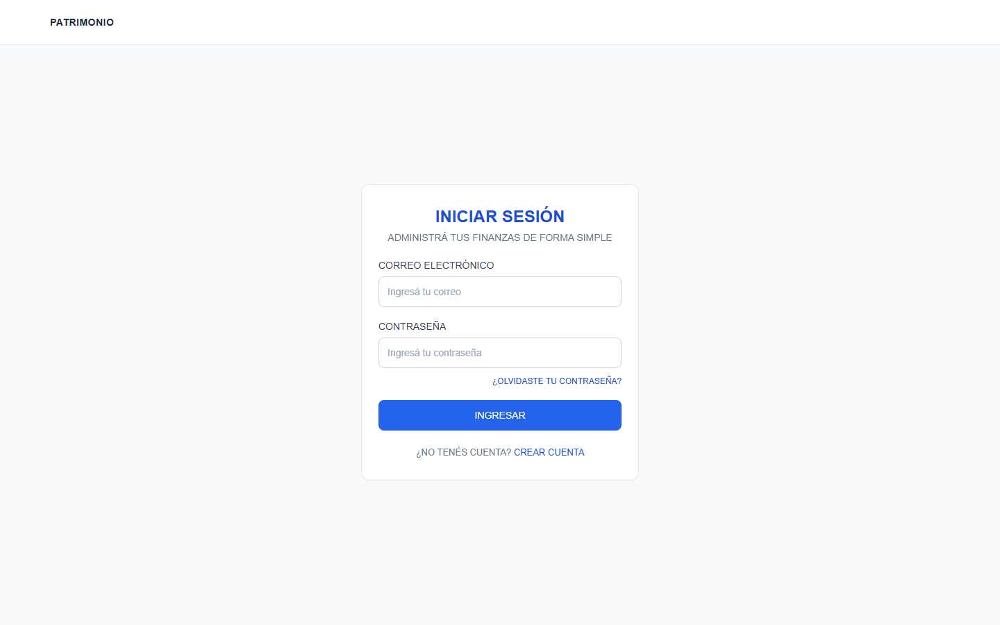 | 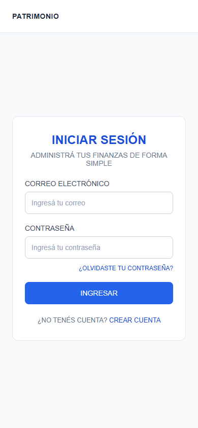 |

### Crear cuenta

| Escritorio | Móvil |
|---|---|
| 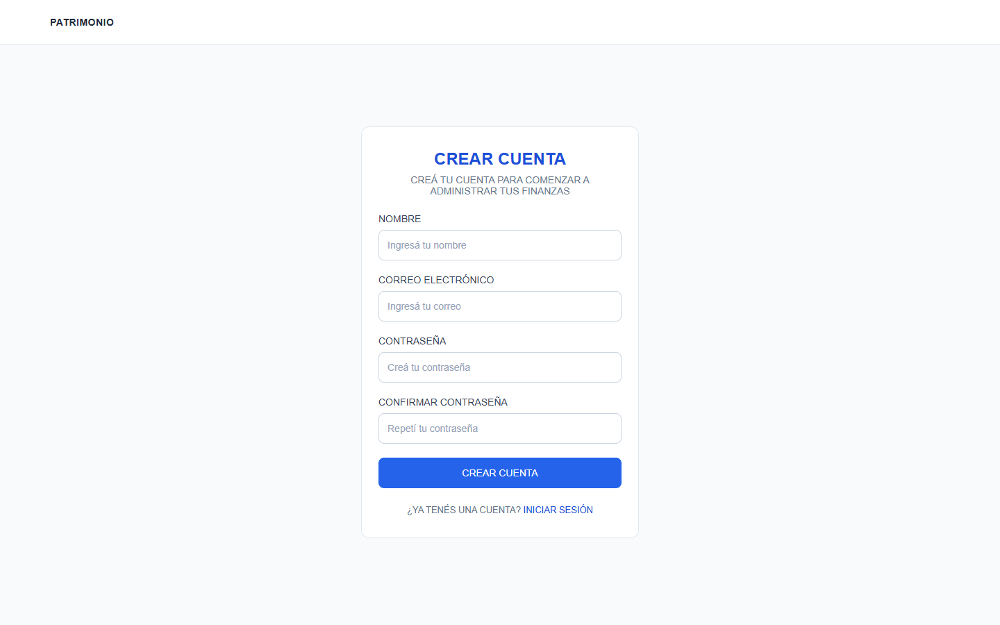 | 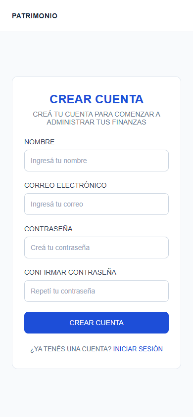 |

### Recuperar contraseña

| Escritorio | Móvil |
|---|---|
| 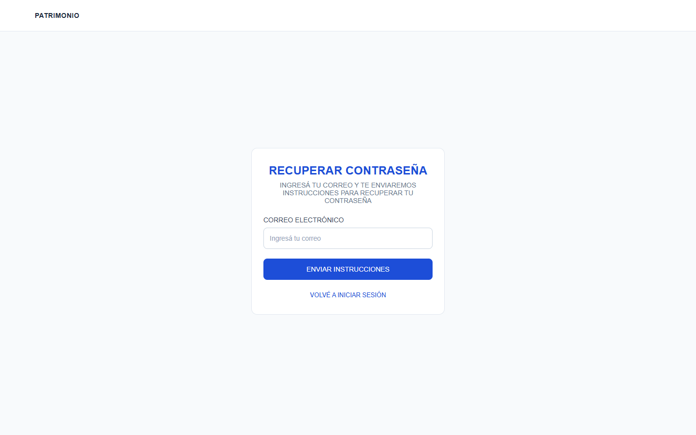 | 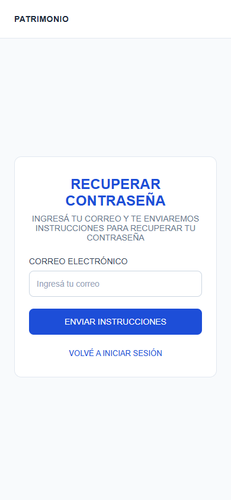 |

### Inicio

| Escritorio | Móvil |
|---|---|
| 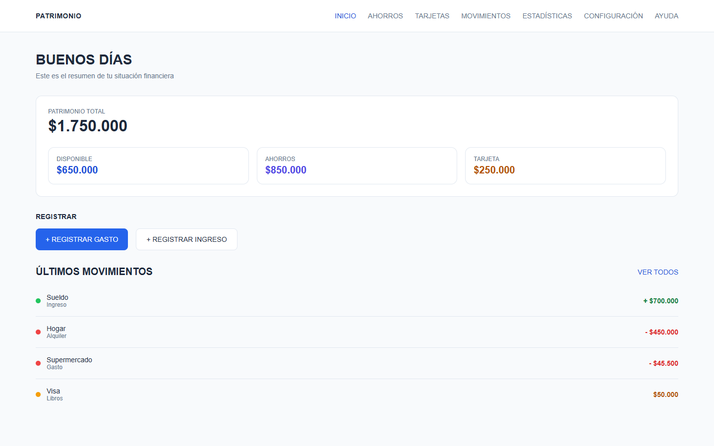 | 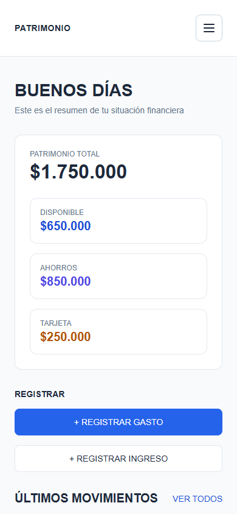 |

### Movimientos

| Escritorio | Móvil |
|---|---|
| 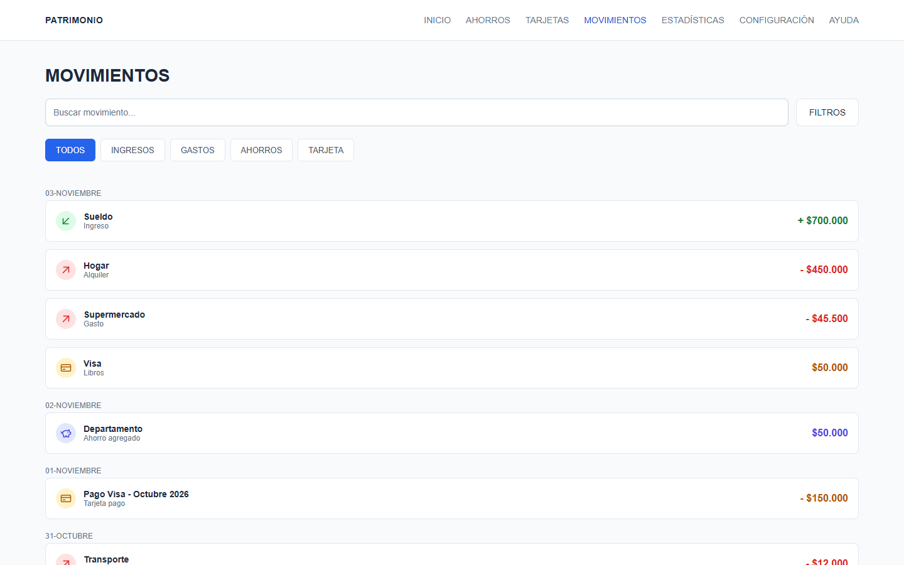 | 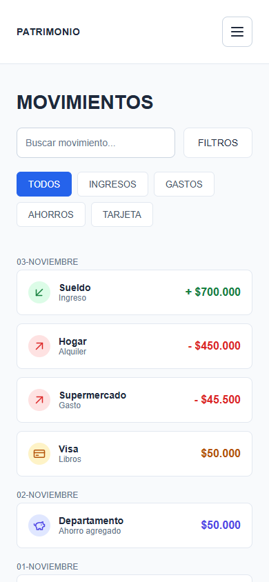 |

### Ahorros

| Escritorio | Móvil |
|---|---|
| 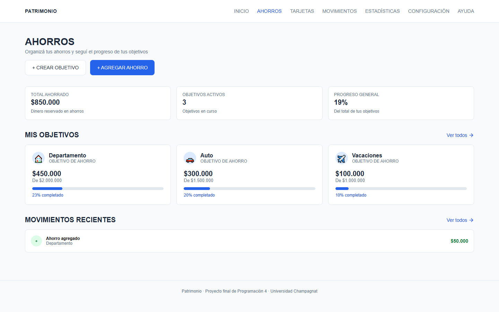 | 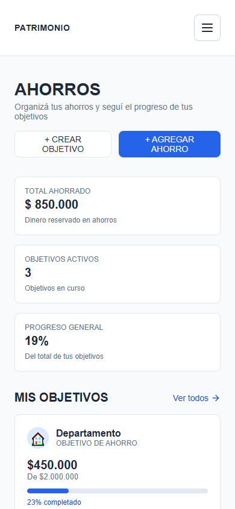 |

### Tarjetas

| Escritorio | Móvil |
|---|---|
| 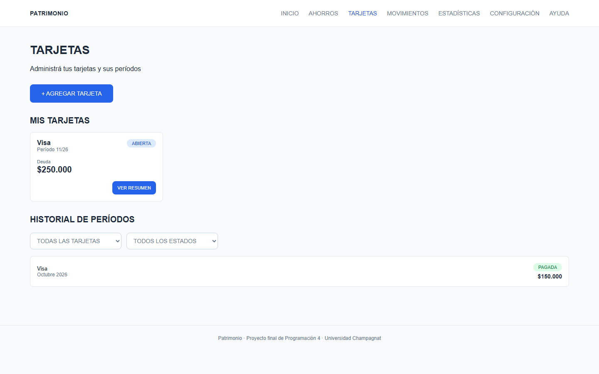 | 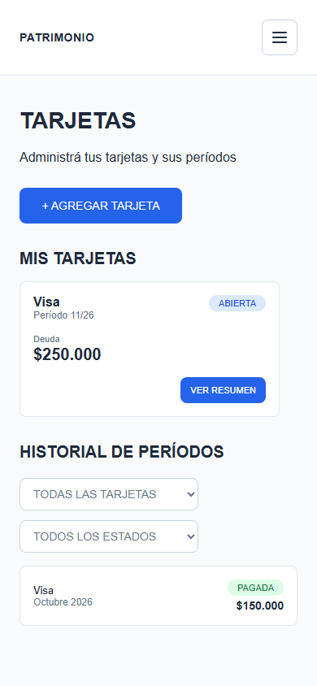 |

### Estadísticas

| Escritorio | Móvil |
|---|---|
| 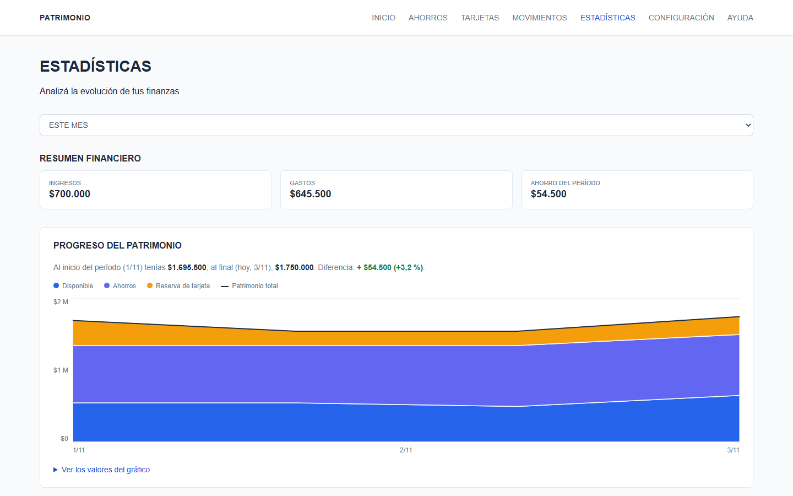 | 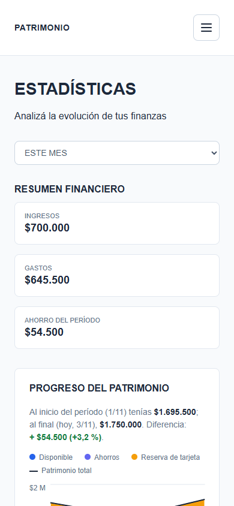 |

### Configuración

| Escritorio | Móvil |
|---|---|
| 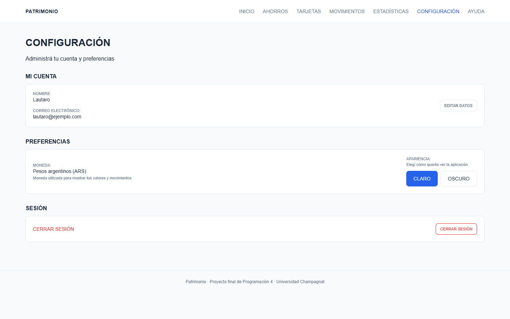 | 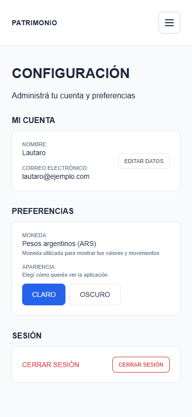 |

### Ayuda

| Escritorio | Móvil |
|---|---|
| 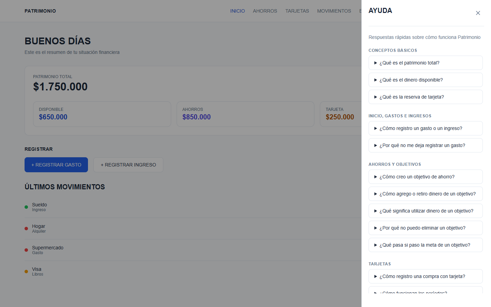 | 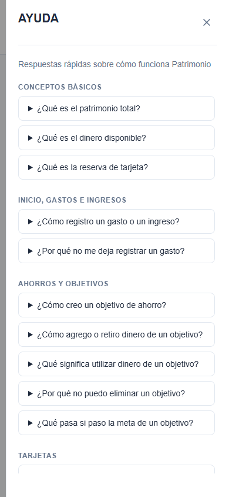 |

## Diseño y presentación

- Presentación de la etapa 1 (Diseño centrado en el usuario): [docs/presentacion-etapa1.pdf](docs/presentacion-etapa1.pdf)
- Figma, diseño de alta fidelidad: https://www.figma.com/design/mAGqEaUlhmfvLpwQLg1DWA
- Figma, wireframes de baja fidelidad: https://www.figma.com/design/Kyz5ZpK25jl90BGIECfA6N/Patrimonio

## Cumplimiento de los requisitos mínimos

- **Pantalla de inicio:** Inicio muestra el patrimonio total, cómo se reparte (disponible, ahorros y tarjeta), los botones para registrar un ingreso o un gasto y los últimos movimientos.
- **Navegación consistente:** el mismo encabezado con el menú en todas las pantallas; en el celular se abre con el botón de menú. La pantalla actual queda marcada.
- **CRUD:** movimientos (crear, ver, editar y eliminar ingresos y gastos), objetivos de ahorro (crear, ver, editar y eliminar) y consumos de tarjeta (agregar, editar y eliminar), todo guardado en el backend.
- **Filtro:** Movimientos filtra por tipo, objetivo, rango de fechas y texto (el filtro lo hace el servidor); Tarjetas filtra el historial de períodos por tarjeta y por estado.
- **Formularios validados:** iniciar sesión, crear cuenta, recuperar contraseña y todos los formularios de montos muestran un mensaje junto al campo con error; el backend vuelve a validar cada pedido.
- **Respuesta a cada acción:** aviso de éxito al registrar un ingreso o gasto en Inicio y al guardar en Configuración; ventanas de confirmación antes de eliminar, cerrar o pagar un período; los datos y totales se actualizan al instante.
- **Estados de carga y error:** "Cargando…" al abrir la aplicación; "No se pudieron cargar los datos" con un botón Reintentar si el backend no responde; "Guardando…" en los botones mientras se espera a la API; "Buscando…" al filtrar movimientos; el error del servidor aparece en el formulario; mensaje cuando una lista está vacía.
- **Responsive:** probado en celular (390 px) y escritorio, sin scroll horizontal; ver las capturas.
- **Accesibilidad:** 100 en Accesibilidad y Buenas prácticas de Lighthouse en las 9 pantallas; revisión con axe-core sin violaciones en tema claro y oscuro; botones de ícono con `aria-label`, ventanas con `role="dialog"` y contraste AA.
- **Consistencia visual:** los mismos colores (definidos en variables de CSS), tipografía, botones, tarjetas y paneles en todas las pantallas, siguiendo el diseño de Figma; incluye modo oscuro.
